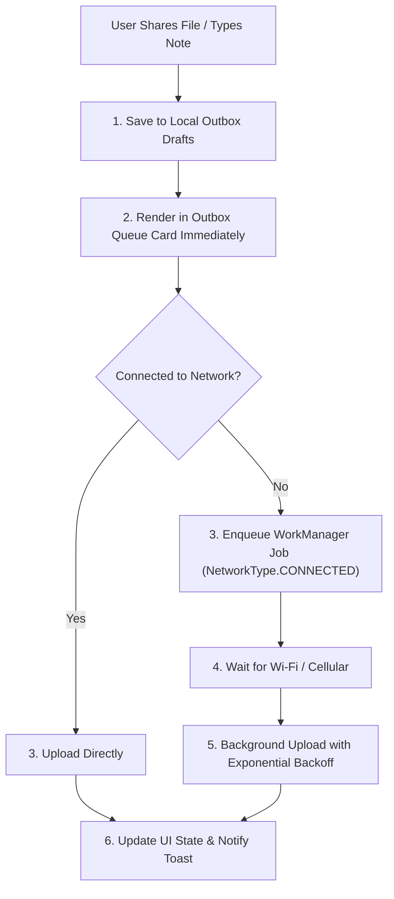

# Android & Mobile UI/UX Engineering Guide

A practical, production-tested operational framework for designing and building native Android applications with Jetpack Compose, Material 3, offline-first resilience, and human-first mobile ergonomics.

---

## 1. Core Mobile Ergonomics & Thumb Zone

Mobile devices are held in one hand over 70% of the time. Design interfaces around thumb reachability, tactile feedback, and minimal physical friction.

### 1.1 The Ergonomic Reachability Hierarchy

```
+---------------------------+  <- Top of Screen (Display Only)
|  Status & Headers         |     Hardest to reach. Reserve for passive
|  Title, Quota Meter       |     status, search bars, and live meters.
+---------------------------+
|                           |  <- Middle Reach Zone
|  Scrollable Content       |     Ideal for list items, details, and
|  Inbox Cards, Snippets    |     browsable content cards.
|                           |
+---------------------------+
|  Primary Action Targets   |  <- Prime Thumb Zone (Bottom 40%)
|  Send Buttons, Tabs       |     Easiest to tap. Keep navigation, CTAs,
|  Bottom Sheets, Filters   |     and interactive controls here.
+---------------------------+
```

### 1.2 Non-Negotiable Touch Target Standards
- **Minimum Interactive Target:** Every clickable element must meet or exceed $48 \times 48\text{dp}$ (`Modifier.sizeIn(minWidth = 48.dp, minHeight = 48.dp)`), even if the visual icon is $24\text{dp}$.
- **Edge Insets & Safe Areas:** Always wrap root Compose layouts in `Scaffold` or apply `Modifier.windowInsetsPadding(WindowInsets.safeDrawing)` to account for camera cutouts, gestures, and navigation bars.
- **Form Controls at the Bottom:** Place text inputs, submission buttons, and confirmation dialogs in `ModalBottomSheet` or bottom-pinned cards so the software keyboard (`imePadding()`) doesn't obscure the active field.

---

## 2. Speed & Perceived Performance

Mobile users perceive delay immediately. Never block navigation or show blank loading states when previously fetched data is available.

### 2.1 The Zero-Skeleton Rule (Stale-While-Revalidate)
- **The Problem:** Showing a full-page skeleton loader or circular spinner every time the user taps the Inbox tab feels slow, jarring, and unpolished.
- **The Solution:** Implement a Stale-While-Revalidate (SWR) cache pattern:
  1. Store fetched items in local encrypted storage (`EncryptedSharedPreferences` or SQLite/Room).
  2. When entering the screen, **render cached items immediately** (0ms delay).
  3. Revalidate in the background if the cache is older than 5–10 minutes.
  4. When refreshed data arrives, smoothly append/update items without clearing the list or showing blank placeholders.
  5. Only show subtle indicators (e.g., a pull-to-refresh spinner or a tiny top progress bar) during background refreshes.

### 2.2 Offline-First Outbox Pattern
Never fail a user action because the mobile device has a spotty cellular connection or is temporarily in airplane mode.



#### Outbox UI States:
- **Pending:** *"Waiting for network…"* with a paused cloud icon.
- **Uploading:** *"Sending 42%…"* with a linear progress indicator.
- **Failed / Retrying:** Clear status indicator with explicit **Retry** and **Discard** buttons.

---

## 3. Motion, Transitions & Tactile Haptics

Modern Android design (Android 14/15+) requires dynamic, physics-based motion and tactile sensory feedback to feel native and responsive.

### 3.1 Edge-to-Edge & System Bar Handling
Always draw behind system bars globally in `MainActivity.kt`:
```kotlin
enableEdgeToEdge()
setContent {
    VaultTheme {
        Scaffold(
            contentWindowInsets = WindowInsets.safeDrawing
        ) { innerPadding ->
            AppNavHost(Modifier.padding(innerPadding))
        }
    }
}
```

### 3.2 Predictive Back Gestures
Enable predictive back in `AndroidManifest.xml` (`android:enableOnBackInvokedCallback="true"`) and use `PredictiveBackHandler` for bottom sheets and detail drawers:
```kotlin
PredictiveBackHandler(enabled = isDetailOpen) { progressFlow ->
    try {
        progressFlow.collect { backEvent ->
            // Scale or shift detail sheet proportional to backEvent.progress (0f to 1f)
            detailScale = 1f - (backEvent.progress * 0.1f)
        }
        // User committed back gesture
        closeDetail()
    } catch (e: CancellationException) {
        // User aborted back gesture, spring back to 1f
        detailScale = 1f
    }
}
```

### 3.3 Shared Element Transitions
When transitioning between an Inbox list row and an item detail view, wrap screens in `SharedTransitionLayout`:
```kotlin
SharedTransitionLayout {
    NavHost(...) {
        composable("inbox") {
            InboxScreen(
                sharedTransitionScope = this@SharedTransitionLayout,
                animatedVisibilityScope = this
            )
        }
        composable("detail/{id}") {
            DetailScreen(
                sharedTransitionScope = this@SharedTransitionLayout,
                animatedVisibilityScope = this
            )
        }
    }
}
```
Use `.sharedElement()` or `.sharedBounds()` on thumbnail cards, avatar icons, and titles to create seamless transitions.

### 3.4 Tactile Haptics
Never leave user actions silent when a physical milestone occurs:
- **Threshold Swipes (Swipe-to-Dismiss):** Trigger `HapticFeedbackConstantsCompat.GESTURE_START` when the swipe crosses the action threshold.
- **Copy to Clipboard / Send Completed:** Trigger `HapticFeedbackConstantsCompat.CONFIRM`.
- **Validation Failure / Network Error:** Trigger `HapticFeedbackConstantsCompat.REJECT`.

```kotlin
val view = LocalView.current
fun triggerHaptic(feedbackConstant: Int) {
    view.performHapticFeedback(feedbackConstant)
}
```

### 3.5 Spring Physics over Linear Easing
Avoid rigid linear animations. Always use spring physics for gestures, sheets, and dismissals:
```kotlin
val offsetAnim by animateFloatAsState(
    targetValue = targetOffset,
    animationSpec = spring(
        dampingRatio = Spring.DampingRatioMediumBouncy,
        stiffness = Spring.StiffnessLow
    )
)
```

---

## 4. Smart One-Tap Actions & System Integration

Mobile interfaces should minimize cognitive load by recognizing the payload type and offering the most relevant native system action.

### 4.1 Context-Aware Action Matrix

| Payload Type | Primary Action | Secondary Action | System Integration |
| :--- | :--- | :--- | :--- |
| **URL / Web Link** | **Open in Browser** (`Intent.ACTION_VIEW`) | **Copy Link** | Chrome Custom Tabs or system default browser |
| **Text / Snippet** | **Copy Text** | **Share** (`Intent.ACTION_SEND`) | Android `ClipboardManager` with instant Toast / Snackbar |
| **File / Media** | **Download to Folder** | **Open File** | Storage Access Framework (SAF) + `FileProvider` |

### 4.2 Direct File Downloads with Custom Default Directory
Prompting the user with the system file picker every time they download a file creates unnecessary friction.
1. Allow the user to select a **Default Download Folder** once in Settings/Hub using `ActivityResultContracts.OpenDocumentTree()`.
2. Persist the permission permanently:
   ```kotlin
   context.contentResolver.takePersistableUriPermission(
       treeUri,
       Intent.FLAG_GRANT_READ_URI_PERMISSION or Intent.FLAG_GRANT_WRITE_URI_PERMISSION
   )
   ```
3. When tapping **Download**:
   - If a default directory is set: Stream bytes directly using `DocumentFile.createFile()`, show live byte progress, and fire a native completion Toast (`"Downloaded document.pdf to Vault"`).
   - If no default is set: Fall back to `ActivityResultContracts.CreateDocument()`.

### 4.3 Safe File Opening with `FileProvider`
Never use insecure raw `file://` URIs. Always delegate file viewing to native Android applications using `FileProvider`:
```xml
<!-- res/xml/file_paths.xml -->
<paths xmlns:android="http://schemas.android.com/apk/res/android">
    <cache-path name="cached_files" path="." />
</paths>
```
```kotlin
val contentUri = FileProvider.getUriForFile(
    context,
    "${context.packageName}.fileprovider",
    tempFile
)
val intent = Intent(Intent.ACTION_VIEW).apply {
    setDataAndType(contentUri, mimeType)
    addFlags(Intent.FLAG_GRANT_READ_URI_PERMISSION)
}
context.startActivity(Intent.createChooser(intent, "Open with..."))
```

---

## 5. Frictionless Mobile Authentication

Typing server URLs and long passwords on mobile touchscreens is prone to typos.

### 5.1 Login Priority Hierarchy
1. **Priority 1: QR Code Camera Scan (1-Second Pairing)**
   - Display a temporary, signed pairing QR code on the desktop web app.
   - Mobile user opens app, taps **Scan QR Code**, points camera at the screen.
   - App parses origin, token, and device name in a single pass—authenticated instantly.
2. **Priority 2: Username & Password with Collapsible Server URL**
   - 99% of logins use the default configured host.
   - Present only **Username** and **Password** fields by default.
   - Hide the server URL behind a subtle collapsible toggle: `"Server configuration (advanced)"`.

### 5.2 14-Day Sliding Session Persistence
- Store access (`va1_`) and refresh (`vr1_`) tokens in Android `EncryptedSharedPreferences`.
- Automatically slide/rotate the refresh token on active usage.
- As long as the user opens the app within 14 days, they remain logged in without re-authenticating.

---

## 6. Adaptive Layouts (Foldables & Tablets)

Build screens that scale smoothly across window size classes using `WindowSizeClass`:
- **Compact (`<600dp`):** Single column, bottom navigation bar, modal bottom sheets.
- **Medium (`600dp - 840dp`):** Navigation rail, two-column grid.
- **Expanded (`>840dp`):** Persistent master-detail two-pane layout side-by-side (List on left, inspector on right).

---

## 7. Reference Open-Source Repositories

Inspect these industry-leading open-source Android projects for design and implementation inspiration:

- **`android/nowinandroid`**: Google's flagship Material 3 Compose sample demonstrating dynamic theming, adaptive layouts, and clean architecture.
- **`skydoves/Pokedex-Compose`**: Production-grade shared element transitions (`.sharedBounds` / `.sharedElement`) and smooth detail sheet gestures.
- **`plainhub/plain-app`**: Outstanding implementation of local phone management, Material You theming, and responsive client-server syncing.
- **`Gurupreet/ComposeCookBook`**: Exhaustive catalog of production Compose animations, bottom bars, and custom canvas micro-interactions.
- **`signalapp/Signal-Android`**: Gold standard for local encrypted storage, background outbox workers, and network resilience.
