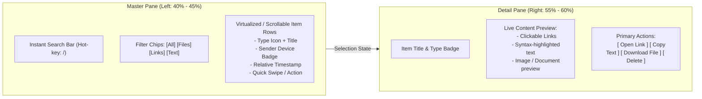

# Modern Web UI/UX & High-Density Workspace Design

A comprehensive operational guide for engineering high-density, zero-waste web applications, utility dashboards, and productive web workspaces.

---

## 1. The Zero-Waste Web Philosophy

Productive web applications (tools, admin panels, communication relays, developer dashboards) are not landing pages. Users arrive to accomplish a task, not to admire marketing graphics.

### 1.1 The Anti-Hero Rule
- ❌ **Anti-Pattern:** Putting a giant 300px decorative hero banner at the top of an app screen (*"Welcome to your Inbox!"*, floating abstract illustrations, huge gradient backgrounds) that pushes actual data and interactive controls below the fold.
- ✔️ **The Zero-Waste Pattern:** Eliminate marketing hero banners entirely from logged-in states. Use a single compact **56px topbar** that integrates:
  1. Subtle brand identity / icon.
  2. Live system telemetry or quota meters (e.g., storage pill: `14 MB / 2 GB`).
  3. Action modal triggers (e.g., "Pair Device").
  4. Quick-theme toggles (Dark / Light).
  5. Compact user dropdown with distinct local logout and security options.

### 1.2 Viewport Maximization
- **100vh Layouts:** Lock the root viewport height (`height: 100vh; overflow: hidden;`) and create independent scrolling containers for content lists and detail inspectors.
- **Zero Accidental Scrollbars:** Eliminate double scrollbars by carefully managing `overflow-y: auto` on internal list containers only.

---

## 2. The Linear-Style High-Density Aesthetic

Inspired by the design paradigms popularized by Linear, Vercel, and Raycast:

### 2.1 Visual Hierarchy & Tokens
- **Subtle 1px Borders:** Avoid heavy drop shadows. Use fine 1px borders (`border-border/40` or `#1E293B`) to establish structure.
- **Deep Slate / Obsidian Backgrounds:** Use high-contrast, non-saturated backgrounds (`#0B0F17` or `#090D16`) rather than pure black (`#000000`) or muddy grays.
- **Monospace Tabular Figures:** Always apply `font-mono tabular-nums` to dates, timestamps, file sizes, and counters so numbers align vertically without layout jitter.
- **Compact Spacing Grid:** Standardize on a 4px/8px rhythm. Pad rows at 8px–10px vertical and 12px horizontal for maximum information density without visual claustrophobia.

### 2.2 Command Menu Palette (`cmdk` Pattern)
In addition to the standard search bar, integrate a global command palette triggered by `⌘K` or `Ctrl+K`:
- Grouped actions: Navigation, Creation, System settings, Account actions.
- Instant fuzzy search across items, files, and shortcuts.
- Fully accessible keyboard navigation (`ArrowDown`, `ArrowUp`, `Enter`, `Escape`).

---

## 3. The Unified Compose Hub Pattern

When an application allows users to create, upload, or send different kinds of data (e.g. text notes, URLs, documents), avoid scattering entry points across different pages or burying them at the bottom.

```
+-------------------------------------------------------------+
| Compose Hub                                                 |
| [ 📝 Text ]  [ 🔗 Web Link ]  [ 📁 File Upload ]            |
+-------------------------------------------------------------+
|                                                             |
|  Active Form / Drag & Drop Target Area                      |
|  - Multi-line textarea for notes                            |
|  - Clean URL input with auto-validation                     |
|  - Drag-and-drop zone with instant file staging preview     |
|                                                             |
+-------------------------------------------------------------+
| Retention: [ 1 Day ] [ 3 Days ] [ 7 Days ]    [ Drop to Vault ↵ ] |
+-------------------------------------------------------------+
```

### Key Elements of an Effective Compose Hub:
1. **Segmented Tab Switcher:** Clean pill tabs with instant switching without form reset.
2. **Drag & Drop Zone:** Native HTML5 drag-and-drop handling with visual border highlighting (`border-dashed border-accent`) and byte size validation.
3. **Live Character & Byte Counting:** Calculate real UTF-8 bytes in real time (e.g., `124 bytes` or `18.4 MB / 100 MB`).
4. **Lifecycle / Retention Controls:** Allow user to set expiration upfront so the system cleans up temporary items automatically.
5. **Keyboard Submission:** `Ctrl + Enter` (or `Cmd + Enter`) to submit from any active text input.

---

## 4. High-Density Master-Detail (Two-Pane) Layouts

For data browsing, master-detail layouts keep context visible while allowing deep inspection.



### Best Practices:
- **Sticky Filter & Search Header:** The search input and filter chips must remain pinned while the item list scrolls underneath.
- **Empty & Zero-Result States:** Provide clear visual states:
  - *No items yet:* "Your inbox is clear. Use the compose hub above to drop your first item."
  - *No search matches:* "No items matching 'tax-return'. [Clear search]."

---

## 5. Keyboard Navigation & Accessibility (a11y)

Power users expect keyboard fluency:

| Shortcut | Action | Implementation |
| :--- | :--- | :--- |
| `/` or `⌘K` | Focus Search Input | `document.addEventListener('keydown', ...)` with `input.focus()` |
| `Escape` | Clear Search / Close Active Modal | Dismisses topmost modal or blurs search field |
| `Ctrl + Enter` | Submit Active Form / Send Item | Form `onKeyDown` handler |
| `Tab` / `Shift + Tab` | Logical DOM Focus Order | Enforce accessible `:focus-visible` rings ($2\text{px}$ blue outline) |

---

## 6. Granular Security & Authentication UX

Do not confuse normal everyday user actions with high-risk security actions.

### 6.1 Local Logout vs. Global Revocation
- **Sign Out (Local):** Clears the session cookie on the current browser only. This is the routine action users take on shared computers.
- **Sign Out Everywhere (Global):** Revokes all active refresh tokens and device sessions across all registered phones, laptops, and browsers.
  - *Safety Rule:* Never place "Sign Out Everywhere" as a direct one-click button in a standard menu. Always gate it behind a dedicated modal with an explicit confirmation step (*"Are you sure? This will disconnect your phone and other devices."*).

### 6.2 Device Pairing UX
- Render pairing QR codes in a lightweight dialog with:
  - High-contrast SVG QR code.
  - Real-time countdown timer (e.g., *"Expires in 09:42"*).
  - Fallback text secret with a one-click copy button for devices without working cameras.

---

## 7. Reference Open-Source Repositories

Inspect these industry-leading repositories for design, token structure, and implementation inspiration:

- **`shadcn/ui`**: Unstyled, accessible component primitives combining Radix UI and Tailwind CSS with modern high-density defaults.
- **`pacocoursey/cmdk`**: The gold standard accessible command menu component used by Linear, Vercel, and Raycast.
- **`henrikzabel/linearlike`**: Curated index of production-grade web applications utilizing the Linear aesthetic.
- **`ln-dev7/circle`**: Open-source Linear-inspired issue tracker demonstrating dense tables and sidebar navigation.
- **`calcom/cal.com`**: Enterprise-grade React workspace layout with clean multi-pane settings, granular dialogs, and instant navigation.
