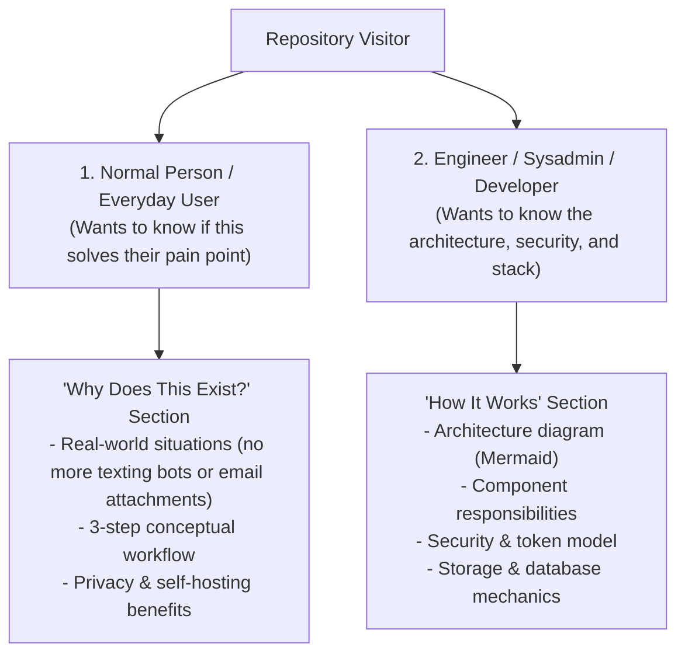

# README Engineering & Technical Documentation Guide

A rigorous framework for creating world-class, human-grade GitHub repository READMEs that respect the reader's time, communicate technical value clearly, and eliminate generic marketing filler.

---

## 1. The Core Philosophy: The 30-Second Rule

Developers and users do not "read" documentation from start to finish—they scan it at high speed. Put yourself in the shoes of a tired developer who just stumbled on your repository at 2 AM.

Your README must answer three questions in under 30 seconds:

1. **What is this?** (A clear, single-sentence definition with zero marketing fluff).
2. **Why should I care?** (The real-world problem it solves and what frustrating workarounds it replaces).
3. **How do I run it right now?** (A 3-step, copy-pasteable quickstart with tested commands).

---

## 2. Guidelines for Clear, Grounded Writing

Documentation often defaults to bloated corporate PR speak. High-quality open-source projects avoid this tone entirely.

### 2.1 The Banned Words & Clichés Dictionary

| ❌ Banned Buzzword / Cliché | ✔️ Clear, Grounded Alternative |
| :--- | :--- |
| *"In today's fast-paced digital landscape..."* | *(Delete entirely. Get straight to the problem).* |
| *"Effortlessly transfer / seamlessly integrate..."* | *"Drop files from your browser and they appear on your phone."* |
| *"A revolutionary, cutting-edge platform..."* | *"A lightweight, self-hosted personal relay."* |
| *"Elevates your productivity to new heights..."* | *"Saves you from emailing links to yourself."* |
| *"A testament to modern development..."* | *(Delete. Speak like an engineer, not a PR agency).* |
| *"Completely eliminated giant hero banners..."* | *(Never brag about internal refactors. State what the UI offers now).* |
| *"Defensive Web Sign-In architecture..."* | *"Secure login using HttpOnly SameSite cookies and CSRF tokens."* |
| *"Zero-skeleton SWR cache..."* | *"Instant loading: opens your inbox without blank white screens."* |

### 2.2 Rules for Authentic Writing
- **The "Tuesday Coffee" Test:** Read your draft out loud. Does it sound like a thoughtful software engineer explaining their favorite tool to a colleague over coffee? If it sounds like a corporate marketing brochure, rewrite it.
- **Badge Discipline:** Limit badges to 3–6 meaningful indicators (Release, Build/CI status, License, Core Stack). Do not stack 15 decorative shields that distract from the project.
- **No Mystery Prerequisites:** Never write `docker compose up` or `npm start` without listing prerequisites and where environment credentials come from.

---

## 3. The Dual-Audience Structure

Great documentation bridges two distinct audiences without compromising on clarity:



### 3.1 Plain English for Everyday Users
Start with relatable real-world friction:
> *"Ever find yourself emailing a link to yourself, messaging a bot on Telegram or WhatsApp just to copy text to your phone, or waiting for cloud drive sync just to move a single PDF? Vault replaces those workarounds with your own private drop-box."*

### 3.2 Grounded Technical Depth for Developers
Follow up with precise architecture and implementation details:
- **API Engine:** ASP.NET Core 10 Minimal APIs streaming files up to 100 MB directly to disk with on-the-fly SHA-256 verification (zero RAM bloat).
- **Web SPA:** React 19 + TypeScript with SameSite HttpOnly cookies, CSRF tokens, and keyboard shortcuts (`/` search).
- **Mobile Client:** Native Kotlin Jetpack Compose with WorkManager offline outbox queues and Android `FileProvider` integration.
- **Database:** PostgreSQL 18 storing metadata and 14-day sliding session tokens.

---

## 4. Visual Showcases & UI Layouts

If your application has a visual interface (Web, Mobile, or CLI output), show it immediately after the introductory pitch.

### 4.1 Responsive Showcase Table Pattern

```html
<table align="center" width="100%">
<tr>
<th width="33%" align="center">📱 Mobile Inbox</th>
<th width="33%" align="center">⚙️ Device Hub</th>
<th width="34%" align="center">🔐 Seamless Pairing</th>
</tr>
<tr>
<td align="center" valign="top">

<br/>
<sub><i>Instant local cache, live search, and one-tap actions.</i></sub>
</td>
<!-- Remaining columns -->
</tr>
</table>
```

### 4.2 Screenshot Rules:
- **Informative Captions:** Use captions to describe what the user can *do* in the view, not to string buzzwords together.
- **Real Screenshots:** Always use crisp captures of actual product UI rather than generic mockup templates with fake laptop frames.

---

## 5. Bulletproof Quickstart Design

Quickstarts must be reproducible without troubleshooting.

### The Standard 3-Step Setup:
```markdown
### 1. Generate Local Certificates & Credentials
```bash
./scripts/setup-local.sh  # or ./scripts/setup-local.ps1
```
*What this does: Generates a trusted localhost TLS certificate in `.local/tls/` and writes a random bootstrap password to `.env`.*

### 2. Start the Stack
```bash
docker compose up -d
```

### 3. Open Your Workspace
Navigate to **https://localhost:8080** in your browser:
- **Username:** `owner@vault.local` (or `owner`)
- **Password:** The bootstrap password in your `.env` file
```

---

## 6. Standard README Structure Checklist

Use this checklist when structuring any technical repository README:

- [ ] **1. Header & Title:** Logo / Icon, Title, and a one-sentence functional tagline.
- [ ] **2. Focused Badges:** Release version, Build status, Core platforms, License.
- [ ] **3. Why This Exists:** The everyday problem, the fix, and the 3-step workflow in plain English.
- [ ] **4. Visual Tour:** Screenshots of Web, Mobile, or CLI interfaces with practical captions.
- [ ] **5. Core Capabilities:** User-centric feature list organized by actual tasks.
- [ ] **6. How It Works (Technical):** Mermaid architecture diagram + concise component breakdown (API, Client, DB, Auth/Security).
- [ ] **7. Quickstart (Docker / Local):** Prerequisites, step-by-step commands, and credential locations.
- [ ] **8. Mobile / Client Setup (if applicable):** Direct download links, pairing instructions, and LAN testing guide.
- [ ] **9. Automated Testing & Verification:** Commands to run backend and frontend test suites locally.
- [ ] **10. Repository Map & Contributing:** Clean ASCII folder tree, guidelines link, and MIT/Apache license.

---

## 7. Reference Open-Source Repositories

Inspect these celebrated open-source READMEs for structural and visual inspiration:

- **`matiassingers/awesome-readme`**: Curated directory of top READMEs across GitHub.
- **`othneildrew/Best-README-Template`**: The industry gold standard for modular, high-impact repository templates.
- **`charmbracelet/bubbletea` & `charmbracelet/gum`**: Exceptional terminal showcases, GIF usage, and scannable code blocks.
- **`supabase/supabase`**: Superb dual-audience balance with clear system architecture diagrams and fast onboarding.
- **`fastapi/fastapi`**: Masterclass in frictionless quickstarts, real code examples, and clear value proposition.
