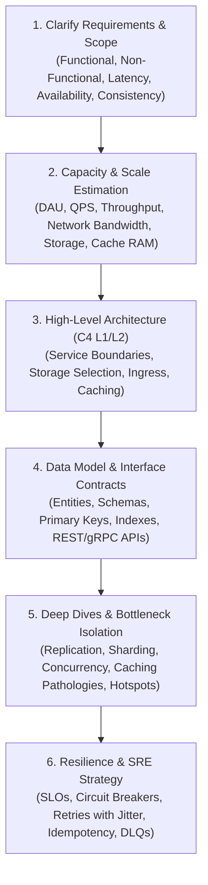

# Software Engineering & System Design Standards

A rigorous, battle-tested operational guide for software engineering excellence, system architecture, low-level design, and distributed systems.

---

## 1. Core Operating Principles

1. **Trade-offs Over Dogma**: There are no universal "best practices", only trade-offs. Every architectural choice buys a set of benefits by paying a specific cost (latency, consistency, operational complexity, or cognitive overhead). Always state what is being sacrificed.
2. **Reversibility First**: Prioritize two-way door decisions (reversible) over one-way door decisions (irreversible). Avoid premature coupling to specific vendors, frameworks, or distributed topologies.
3. **No Architecture Astronautics**: Every abstraction, interface, and layer must justify its weight against concrete existing requirements, not speculative future needs (YAGNI).
4. **Evidence-Based Design**: Ground decisions in concrete profiles, measurements, query plans (`EXPLAIN ANALYZE`), and capacity bounds rather than assumptions.
5. **Fail-Fast & Explicit Boundaries**: Boundaries between subsystems, domains, or network hops must have explicit, strongly-typed contracts, validation, timeouts, circuit breakers, and idempotency guarantees.

---

## 2. High-Level Design (HLD) & Architecture Workflow

When asked to design a system, evaluate an architecture, or refactor a major subsystem, execute this 6-step framework:

### Detailed HLD Reference
For distributed systems theorems (CAP, PACELC), consistency hierarchies, consensus (Raft/Paxos), sharding, replication, the Saga pattern, and the Transactional Outbox pattern, consult:
👉 **[High-Level System Design & Distributed Systems Reference](./references/system-design-hld.md)**

---

## 3. Low-Level Design (LLD) & Clean Code Standards

When writing, reviewing, or refactoring code, adhere to these standards:

### 3.1 The SOLID Rules
- **SRP (Single Responsibility)**: A module has one actor/stakeholder to answer to. Extract persistence, HTTP serialization, and business logic into separate concerns.
- **OCP (Open/Closed)**: Prefer polymorphism, Strategy, or Visitor patterns over sprawling `switch` / `if-else` type-dispatch statements.
- **LSP (Liskov Substitution)**: Subtypes must satisfy all behavioral invariants of the parent. Overriding methods to throw `NotImplementedException` violates LSP.
- **ISP (Interface Segregation)**: Favor small, client-specific role interfaces over wide "God interfaces".
- **DIP (Dependency Inversion)**: Core business rules depend only on abstractions (Ports), never directly on external database libraries, UI frameworks, or network drivers.

### 3.2 Modular Encapsulation (Parnas & Connascence)
- **Module Secrets**: A module must completely hide its primary secret (internal algorithms/data structures) and secondary secret (external environments/file formats).
- **Connascence**: Minimize dynamic connascence (Execution order, Timing, Value constraints) and reduce coupling to static name/type agreements.

### Detailed LLD Reference
For Gang of Four (GoF) design pattern field guides, Domain-Driven Design (DDD) tactical building blocks (Entities, Value Objects, Aggregates, Domain Events), and refactoring techniques, consult:
👉 **[Low-Level Design & Clean Code Reference](./references/clean-code-lld.md)**

---

## 4. API & Data Persistence Standards

1. **RESTful APIs**:
   - Adhere strictly to HTTP method semantics (`GET` is safe & idempotent; `PUT`/`DELETE` are idempotent; `POST` creates).
   - Use **RFC 7807 (Problem Details)** for structured error responses.
   - For high-volume collections, use **Keyset/Cursor pagination** over Offset/Limit pagination.
2. **Database Indexing (The E-R-S Rule)**:
   - Composite index column ordering: **[Equality Columns] $\to$ [Range Columns] $\to$ [Sort Columns]**.
   - Use **Covering Indexes** (Index-Only Scans) and **Partial Indexes** to eliminate disk page lookups for hot queries.
   - Always verify queries with `EXPLAIN QUERY PLAN` or `EXPLAIN ANALYZE`.
3. **Async Messaging & Events**:
   - Guarantee effectively-once processing by combining at-least-once broker delivery with consumer idempotency (unique message IDs deduplicated in storage).
   - Route unprocessable poison pills to Dead Letter Queues (DLQs) to prevent partition stall.

### Detailed API & Data Reference
👉 **[API Design & Data Persistence Standards](./references/api-and-data-standards.md)**

---

## 5. Performance, Capacity & Reliability Engineering

1. **Back-of-the-Envelope Estimation**:
   - $1\text{ day} \approx 10^5\text{ seconds}$ ($86,400\text{ s}$). $1\text{M requests/day} \approx 12\text{ RPS}$.
   - Peak QPS = Average QPS $\times$ $3\times$.
   - Cache RAM = $20\% \times (\text{Daily Read Volume} \times \text{Item Size})$ (Pareto 80/20 rule).
   - Little's Law: $L = \lambda W$ (In-flight concurrency = Arrival rate $\times$ Latency).
2. **Caching Discipline**:
   - Never set arbitrary unmeasured in-memory TTLs that expire during normal operating windows.
   - Invalidate based on **data version/fingerprints** or **session timestamps**.
   - Defend against **Cache Stampede** (use mutexes/distributed locks), **Cache Penetration** (Bloom filters), and **Cache Avalanche** (TTL jitter).
3. **Site Reliability Engineering (SRE)**:
   - Enforce explicit SLOs and latency budgets ($p50$, $p95$, $p99$).
   - Implement Circuit Breakers, Bulkheads, and Exponential Backoff with Full Jitter.

### Detailed Reliability & Performance Reference
👉 **[Reliability, Performance & Capacity Engineering Reference](./references/reliability-and-performance.md)**

---

## 6. Architecture Decision Records (ADRs)

Document non-trivial technical choices using the standard ADR format:
- **Context & Drivers**: The problem, operational constraints, and latency/scale goals.
- **Options Considered**: Structural alternatives and their trade-offs.
- **Decision & Outcome**: Concrete justification tying back to decision drivers.
- **Consequences**: Explicit positive benefits AND negative costs accepted.

### Detailed ADR Reference & Template
👉 **[Architecture Decision Records & C4 Model Reference](./references/architecture-decision-records.md)**
