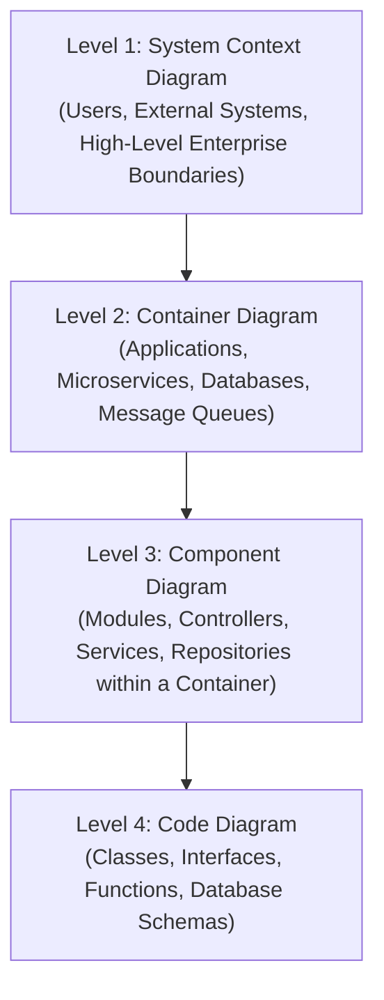

# Architecture Decision Records (ADRs) & Engineering Governance

This reference establishes standards for recording architectural decisions, visualizing systems with the C4 model, and evaluating trade-offs rigorously.

---

## 1. Architecture Decision Records (ADR) Standard

Every non-trivial architectural choice, technology selection, or structural trade-off must be documented in an ADR.

### 1.1 Standard ADR Template (Markdown Format)

```markdown
# ADR-[NUMBER]: [Short Title in Imperative Form, e.g., Adopt Keyset Pagination for Conviction Queries]

**Status**: [Proposed | Accepted | Superseded by ADR-XXX | Deprecated]  
**Date**: YYYY-MM-DD  
**Deciders**: [Names / Roles]  
**Technical Story**: [Link to Issue, Ticket, or PR]

## 1. Context and Problem Statement
What is the problem we are trying to solve? Describe the operational, technical, or business
context. What constraints (latency, throughput, team skill, infrastructure cost) bound the solution?

## 2. Decision Drivers
- [Driver 1, e.g., Endpoint response time must be under 100ms at p99]
- [Driver 2, e.g., Eliminate memory exhaustion and large payload serialization overhead]
- [Driver 3, e.g., Zero breaking changes to existing consumer APIs]

## 3. Considered Options
- Option 1: [Name / Description]
- Option 2: [Name / Description]
- Option 3: [Name / Description]

## 4. Decision Outcome
Chosen option: "[Option X]", because [justification linking to Decision Drivers].

### Positive Consequences
- [Benefit 1, e.g., Query execution time drops from 52s to 12ms]
- [Benefit 2, e.g., Payload size drops from 9.6MB to 50KB]

### Negative Consequences / Trade-offs
- [Trade-off 1, e.g., Requires caching technical indicators by daily session date]
- [Trade-off 2, e.g., Cannot jump directly to arbitrary page N without traversing cursors]

## 5. Pros and Cons of the Options

### Option 1: [Title]
- Good, because [argument]
- Bad, because [argument]

### Option 2: [Title]
- Good, because [argument]
- Bad, because [argument]

## 6. Validation & Verification Plan
How will we prove this decision succeeded in production?
- [Step 1: Benchmark endpoint locally and measure latency under simulated concurrency]
- [Step 2: Monitor p95 latency and memory usage on production metrics dashboard]
```

---

## 2. The C4 Model for Visualizing Software Architecture

The C4 model (Simon Brown) provides a hierarchical, zoomable framework for visualizing architecture:



1. **Level 1 - System Context**: Shows who uses the system (actors/personas) and what external software systems it interacts with. Zero technical buzzwords; clear business context.
2. **Level 2 - Container**: Shows high-level executable units, network boundaries, and storage nodes (e.g., React SPA, Node.js API Gateway, PostgreSQL DB, Redis Cache, Kafka Cluster).
3. **Level 3 - Component**: Zooms into one container to show internal architectural modules (e.g., `AuthenticationController`, `ConvictionEvaluationEngine`, `ChartReadService`).
4. **Level 4 - Code**: Shows implementation-level design (UML class diagrams, ER diagrams, interface contracts). Only document critical or novel patterns here.

---

## 3. Architecture Review & Anti-Pattern Checklist

Before accepting any design or major refactor, audit against these common architectural traps:

1. **Architecture Astronautics**:
   - Creating layers of abstraction, factories-of-factories, and generic interfaces for hypothetical future requirements that never arrive.
   - *Check*: Does every layer of abstraction solve an existing, concrete problem today?
2. **Distributed Monolith**:
   - Microservices that must be deployed simultaneously, share a single database, or engage in synchronous chatty request-response waterfalls across network hops.
   - *Check*: Can each service be deployed independently without breaking its peers?
3. **Dual Writes**:
   - Writing to a database and publishing to a message broker in the same application block without a transactional outbox. A crash between the two creates permanent split-brain inconsistency.
4. **Hidden Temporal Coupling**:
   - Assuming step B will run after step A across distributed networks without explicit saga orchestration, idempotency checks, or monotonically increasing version clocks.
5. **Entity Service Anti-Pattern**:
   - Creating a microservice for every database table (e.g., `UserService`, `OrderService`, `PaymentService`), forcing all business workflows to coordinate across high-latency network boundaries.
