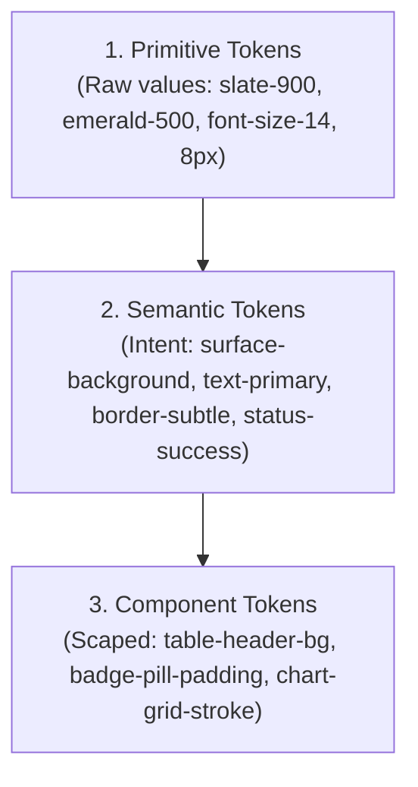
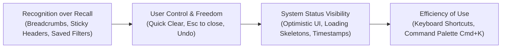

# UI/UX Engineering & Modern Product Design Systems

A rigorous, institutional-grade operational guide for user interface engineering, UX architecture, design tokens, component libraries, and product aesthetic transformations.

---

## 1. Core Operating Principles

1. **Information Density with Breathing Room**: High-density layouts (Linear, Bloomberg, Stripe, TradingView) present maximum signal per viewport pixel without clutter. This is achieved through deliberate contrast, compact typographic scales, 1px subtle borders, and consistent spacing grids (4px / 8px).
2. **High-Craft Design Guidelines**: Reject unrefined, generic defaults:
   - ❌ *No oversaturated purple/indigo gradients.*
   - ❌ *No unreadable low-contrast gray-on-gray text (`text-gray-400` on white or `text-zinc-600` on black).*
   - ❌ *No emoji icons instead of crisp vector SVGs (Lucide / Radix).*
   - ❌ *No giant empty floating cards with massive radii (`rounded-3xl`) and tiny unaligned text.*
   - ❌ *No missing keyboard focus states or mouse-only interactions.*
   - ✔️ *Use purposeful color palettes, subtle 1px borders (`border-slate-800`), monospace tabular figures (`font-mono tabular-nums`), crisp micro-badges, and accessible contrast ratios ($>4.5:1$).*
3. **Domain-Specific Color Semantics**:
   - In financial / quantitative applications, color carries high-stakes semantic meaning.
   - Green (`#10B981` / `#22C55E`): Positive alpha, profitability, buy signals, upward growth.
   - Red (`#EF4444` / `#F43F5E`): Losses, drawdowns, forensic risks, sell signals, negative cash flow.
   - Amber / Yellow (`#F59E0B`): Caution, triage required, neutral regime, warning flags.
   - Blue / Cyan (`#3B82F6` / `#06B6D4`): Informational states, focus rings, primary action buttons, neutral trends.
   - *Color-blind accessibility*: Never rely on color alone. Pair color indicators with directional glyphs (`▲`, `▼`, `—`), status badges, or tooltips.
4. **Predictable Perceived Performance**:
   - Zero layout shifts (CLS < 0.1): Reserve skeleton space for lazy-loaded charts and tables.
   - Optimistic feedback: Instant active states (<50ms feedback) on button clicks and filter switches.
   - Skeletons over full-page spinners: Retain page layout and navigation chrome while data hydrates.

---

## 2. Design Token Architecture

A robust design system is structured in three explicit token tiers:



### 2.1 Color Token Matrix (Institutional Dark & Light Themes)

| Semantic Token | Dark Mode Value | Light Mode Value | Usage |
| :--- | :--- | :--- | :--- |
| `bg-app` | `#0B0F17` (Deep Obsidian) | `#F8FAFC` (Slate Tint) | Root viewport background |
| `bg-surface` | `#111827` (Rich Zinc/Slate) | `#FFFFFF` (Pure White) | Cards, panels, modal dialogs |
| `bg-surface-hover` | `#1E293B` (Muted Blue-Gray) | `#F1F5F9` (Light Slate) | Table row hover, menu item hover |
| `border-subtle` | `#1E293B` (1px clean border) | `#E2E8F0` | Card borders, table dividers |
| `border-accent` | `#334155` | `#CBD5E1` | Focused inputs, active tab borders |
| `text-primary` | `#F8FAFC` (High contrast, 16:1) | `#0F172A` | Primary headings, table data values |
| `text-secondary` | `#94A3B8` (Slate 400, 7:1) | `#475569` | Metric labels, descriptions, timestamps |
| `text-muted` | `#64748B` (Slate 500, 4.5:1) | `#64748B` | Footers, disabled states, shortcut hints |
| `accent-primary` | `#2563EB` (Royal Blue) | `#2563EB` | Primary CTA buttons, active radio tabs |
| `status-bullish` | `#10B981` (Emerald) | `#059669` | Gains, Buy conviction, Positive CAGR |
| `status-bearish` | `#EF4444` (Rose/Red) | `#DC2626` | Drawdowns, Disqualifications, High Debt |
| `status-caution` | `#F59E0B` (Amber) | `#D97706` | Stale data, Needs Review, Moderate Flags |

### 2.2 Typography Scale & Numerical Formatting

```css
/* Essential for financial terminals & high-density tables */
.tabular-numbers {
  font-family: var(--font-mono), monospace;
  font-variant-numeric: tabular-nums;
  letter-spacing: -0.02em;
}
```

- **Headings (Display/Title)**: Semi-bold / Bold (600/700), tight tracking (`letter-spacing: -0.03em`), line-height 1.2.
- **Body & Controls**: 13px–14px (`text-sm`), medium (500) for interactive labels, regular (400) for text.
- **Micro Labels & Badges**: 11px–12px (`text-xs`), bold/semibold (600/700), uppercase with `tracking-wider`.
- **Numbers & Metrics**: Monospace tabular font (`JetBrains Mono`, `Roboto Mono`, or `Inter` with `tabular-nums`), right-aligned in all tables.

---

## 3. High-Density Financial Terminal & Table UX

Data tables are the core engine of financial and analytical workflows. Follow these non-negotiable rules:

1. **Alignment Rules**:
   - Text, symbols, and company names: **Left-aligned**.
   - Numerical metrics (Price, P/E, ROCE, CAGR, Scores, Dates): **Right-aligned**.
   - Status badges, actionable flags, icons: **Center-aligned**.
2. **Sticky Column & Multi-Row Headers**:
   - Header row must stick during vertical scrolling (`sticky top-0 bg-surface z-10`).
   - Sticky identifier column (Company Name / Symbol) on horizontal scroll for mobile and ultra-wide tables.
3. **Visual Structure**:
   - Row height: Compact (36px–40px) or standard (44px) with subtle zebra striping or crisp 1px borders (`border-b border-slate-800/60`).
   - Instant row hover highlighting (`hover:bg-slate-800/40 cursor-pointer`).
   - Direct inline badge pills (`bg-emerald-500/10 text-emerald-400 border border-emerald-500/20 px-2 py-0.5 rounded text-xs font-semibold`).
4. **Interactive Controls**:
   - Sort indicator arrows (`▲` active ascending, `▼` active descending, muted `⇅` sortable).
   - Instant search with clear button (`X`), active filter count chips (`Filters (3)`), and pagination controls with total count (`Showing 1–50 of 1,060`).

---

## 4. Usability & Interaction Architecture (Nielsen Norman Heuristics)



1. **Visibility of System Status**:
   - Always display "As of [Market Date/Time]" on financial data so the user knows if the market is live or closed.
   - When requests take >100ms, display localized skeletons rather than blank screens or blocking spinners.
2. **User Control & Freedom**:
   - Filter bars must have a one-click "Reset All Filters" button when any non-default filter is active.
   - Modals and drawers must close on `Escape` key and backdrop click.
3. **Consistency & Component Hierarchy**:
   - **Primary Action**: Solid high-contrast fill (`bg-blue-600 hover:bg-blue-500 text-white`). Exactly one primary CTA per view.
   - **Secondary Action**: Bordered / subtle fill (`bg-slate-800 hover:bg-slate-700 text-slate-200 border border-slate-700`).
   - **Ghost Action**: Transparent (`hover:bg-slate-800 text-slate-400 hover:text-slate-100`).
   - **Destructive Action**: Red-tinted warning (`bg-rose-600/10 hover:bg-rose-600/20 text-rose-400 border border-rose-500/30`).
4. **Accessibility (WCAG 2.2 AA / AAA)**:
   - Text-to-background contrast ratio $\ge 4.5:1$ for normal body text, $\ge 3:1$ for large text and UI components.
   - All interactive elements must have visible `:focus-visible` focus rings (`ring-2 ring-blue-500 ring-offset-2 ring-offset-slate-900`).
   - Minimum clickable touch targets: $44 \times 44$px on touch devices.

---

## 5. WCAG 2.2 AA / AAA Color Contrast Engineering & Verification

Contrast is not aesthetic preference; it is a mathematical engineering specification. Low contrast causes severe cognitive fatigue, legibility failure under glare or low brightness, and accessibility compliance violations.

### 5.1 Mathematical Contrast Ratio Specification
The relative luminance $L$ of any sRGB color is computed using the CIE formula:
$$L = 0.2126 R_s + 0.7152 G_s + 0.0722 B_s$$
where each color channel $C \in \{R, G, B\}$ is linearized from 8-bit sRGB ($C_{\text{srgb}} = C_{8\text{bit}} / 255$):
$$C_s = \begin{cases} \frac{C_{\text{srgb}}}{12.92} & \text{if } C_{\text{srgb}} \le 0.04045 \\ \left(\frac{C_{\text{srgb}} + 0.055}{1.055}\right)^{2.4} & \text{if } C_{\text{srgb}} > 0.04045 \end{cases}$$

The contrast ratio between a lighter color ($L_1$) and a darker color ($L_2$) is:
$$\text{Contrast Ratio} = \frac{L_1 + 0.05}{L_2 + 0.05} : 1$$

### 5.2 Strict Compliance Thresholds

| Element Category | WCAG 2.2 AA Minimum | WCAG 2.2 AAA Target | Verification Standard |
| :--- | :--- | :--- | :--- |
| **Normal Body Text** (< 18pt / 24px regular, < 14pt / 18.5px bold) | **$\ge 4.5:1$** | **$\ge 7.0:1$** | Primary data, labels, descriptions, table rows, button labels |
| **Large Text & Headings** ($\ge 18\text{pt}$ / $24\text{px}$, or $\ge 14\text{pt}$ bold) | **$\ge 3.0:1$** | **$\ge 4.5:1$** | Display titles, section headers, prominent metric numbers |
| **UI Components & Graphical Objects (WCAG 1.4.11)** | **$\ge 3.0:1$** | **$\ge 4.5:1$** | Input borders, toggles, segmented tab boundaries, active chip outlines, focus rings |
| **Use of Color (WCAG 1.4.1)** | Non-color indicator required | Dual-encoding required | Never convey selection or status by color alone; pair with checkmarks, icons, or text weight |

### 5.3 The 5 Common Contrast Traps & Systematic Fixes

#### 1. The Dark-Mode Segmented Tab Blend
- **The Defect**: An active tab set to `--card: #111827` inside a container set to `--tab-bg: #0F172A`. The contrast ratio is **1.02:1** (a 2-unit RGB delta). The selected tab completely blends into the container background, making it impossible for the user to determine the active selection.
- **The Fix**: Elevate the active tab background to `--card-elevated: #1E293B`, add an active 1px semantic border (`1px solid var(--accent)` / `#10B981`), a subtle glow ring (`box-shadow: 0 0 0 1px rgba(16, 185, 129, 0.25)`), and tint the active tab's SVG icon to match.

#### 2. The Light-Mode Muted Text Contrast Failure
- **The Defect**: Default secondary/muted text using Slate-400 (`#94A3B8`) on white (`#FFFFFF`) or light paper (`#F8FAFC`). Contrast ratio is **2.57:1**, severely failing WCAG SC 1.4.3 ($\ge 4.5:1$).
- **The Fix**: Darken light-mode secondary text to at least Slate-500 (`#64748B`), which yields **4.77:1** on `#FFFFFF` and **4.54:1** on `#F8FAFC`.

#### 3. The Amber / Warning Text Badge Failure
- **The Defect**: Using bright amber (`#D97706` / Amber-600) on pure white for status pills. Contrast ratio is **3.22:1**, failing the 4.5:1 text threshold.
- **The Fix**: Darken to Amber-700 (`#B45309`) for text badges in light mode, achieving **4.82:1** while maintaining semantic warmth.

#### 4. Invisible Dark-Mode Input & Control Boundaries (WCAG 1.4.11)
- **The Defect**: Subtle 8%–12% white opacity borders (`rgba(255, 255, 255, 0.08)`) on dark slate surfaces (`#111827` / `#0B0F17`) have a contrast ratio of only **1.2:1–1.4:1**, violating the 3:1 non-text boundary requirement.
- **The Fix**: Set default dark-mode input borders to at least **18% white opacity** (`rgba(255, 255, 255, 0.18)` / `#334155`) and hover states to **32%** (`rgba(255, 255, 255, 0.32)` / `#475569`).

#### 5. The Android Material 3 Dark-Mode FilterChip Trap
- **The Defect**: In Material 3, default selected `FilterChip` uses `secondaryContainer` (`#37474F`) against the dark surface (`#14181E`), yielding only **1.83:1** contrast. Without an outline or glyph, the chip fails both SC 1.4.11 and SC 1.4.1.
- **The Fix**: Explicitly specify:
  1. `selectedBorderColor = MaterialTheme.colorScheme.primary` (which yields **9.88:1** contrast).
  2. `selectedBorderWidth = 1.5.dp`.
  3. `leadingIcon = if (selected) { { Icon(Icons.Filled.Done, ...) } } else null` so selection is visible independent of color perception.

---

## 6. UI/UX Revamp Playbook (Phase-Wise Execution)

When tasked with redoing or modernizing an existing application's UI/UX, follow this 4-step execution strategy:

### Step 1: Design System Foundation & Token Extraction
- Establish the color palette, typography scale, spacing variables, and border radius hierarchy in CSS/Tailwind (`globals.css` / `tailwind.config.js`).
- Introduce institutional dark mode tokens and semantic color classes.

### Step 2: Component Primitives Modernization
- Refactor core reusable UI primitives:
  - `Button`: Primary, secondary, ghost, destructive, with loading spinners.
  - `Badge` / `Tag`: Semantic colored pills for status, tiers, and momentum.
  - `Card` / `Panel`: Clean borders, rounded corners (`rounded-lg` or `rounded-xl`), subtle backgrounds.
  - `DataTable`: Header sorting, right-aligned numbers, sticky header, hover rows.
  - `Modal` / `Drawer`: Backdrop blur, focus trap, smooth entrance animations.
  - `Tooltip`: Informative explanations for complex metrics (e.g. EV/EBITDA, CANSLIM score).

### Step 3: Layout & Navigation Overhaul
- Modernize top navigation bar / sidebar with clear active route indicators, company search bar, system status indicator (e.g., market session date, API health).
- Eliminate layout jank and page jump on route transitions.

### Step 4: High-Value Page Modernization
- Revamp the critical user-facing views:
  - **Dashboard**: Executive summary tiles, market pulse, top gainers/losers, regime heatmaps.
  - **Conviction / Screener**: High-density table with fast search, sortable columns, metric pills, and quick detail drawer.
  - **Company Workspace / Detail**: Interactive charts with timeframe pills (1M, 6M, 1Y, 5Y, All), clean financial tabs (P&L, Balance Sheet, Cash Flow, Forensics, Valuation).
