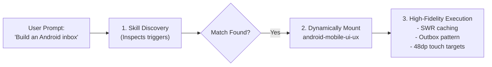

# Agentic Skills ⚡

<div align="center">

### *Modular operational playbooks, engineering guidelines, and design standards for autonomous AI coding agents.*

[](LICENSE)
[](#included-skills)
[](#compatibility)
[](#why-agentic-skills)

---

</div>

## Why Agentic Skills?

Most AI coding agents generate code that technically compiles, but often falls victim to common anti-patterns and unrefined defaults:
- ❌ **Web UI:** Giant 300px decorative hero banners on tool dashboards, muddy gray-on-gray low-contrast text, oversaturated purple/indigo gradients, and missing keyboard navigation.
- ❌ **Mobile Apps:** Jarring full-screen skeleton loaders on every tab navigation, failing silent network drops without an outbox, and prominent "Sign Out Everywhere" buttons placed in standard menus.
- ❌ **Documentation:** Bloated PR-speak (*"In today's fast-paced world, our revolutionary cutting-edge platform seamlessly empowers..."*), broken quickstarts, and bragging about internal refactors.
- ❌ **Software Architecture:** Architecture astronautics, premature microservices, dogmatic design patterns, and missing idempotency boundaries.

**Agentic Skills fixes this.** It is an open, portable collection of operational playbooks that teach autonomous coding agents the **instincts, taste, and discipline of senior engineers and product designers**.

---

## Included Skills

| Skill | Focus & Capabilities | Primary Triggers |
| :--- | :--- | :--- |
| [**`android-mobile-ui-ux`**](skills/android-mobile-ui-ux/SKILL.md) | **Native Android & Mobile Ergonomics**<br>• The Thumb Zone (bottom 40% reachability & $48\text{dp}$ touch targets)<br>• Zero-skeleton SWR caching (0ms tab transitions)<br>• Offline-first outbox queues with `WorkManager` background sync<br>• Material 3 color contrast & dual-encoding state chips (WCAG 1.4.1/1.4.11)<br>• Predictive back gestures & shared element transitions<br>• Storage Access Framework (SAF) & `FileProvider` safe intents | Android, Compose, Material 3, mobile UX, gestures, haptics, outbox |
| [**`modern-web-ui-ux`**](skills/modern-web-ui-ux/SKILL.md) | **High-Density, Zero-Waste Web Workspaces**<br>• The Anti-Hero Rule (elimination of decorative banners in tools)<br>• 56px unified telemetry topbars<br>• Linear-style design tokens (1px borders, `#0B0F17` slate, monospace tabular numbers)<br>• WCAG 2.2 AA/AAA token auditing & high-contrast active tabs<br>• Command palette (`cmdk`) navigation (`⌘K` / `/`)<br>• Master-detail two-pane browsing with zero layout shift | Web UI, React, dashboards, high-density, command menu, Linear style |
| [**`readme-engineering`**](skills/readme-engineering/SKILL.md) | **Human-Grade Technical Documentation**<br>• The 30-Second Rule & "2 AM Test"<br>• Banned Buzzwords & Anti-Patterns (eliminating corporate PR filler)<br>• Dual-audience narrative (plain English for users + grounded technical depth for engineers)<br>• Reproducible, copy-pasteable 3-step quickstarts<br>• S-tier visual showcase tables | README, documentation, quickstarts, guides, open-source presentation |
| [**`software-engineering-and-system-design`**](skills/software-engineering-and-system-design/SKILL.md) | **Architecture, Clean Code & Distributed Systems**<br>• Trade-offs over dogma (stating costs for every architectural benefit)<br>• 6-step High-Level Design (HLD) framework (scale, C4 models, SLOs)<br>• Clean code & Low-Level Design (LLD) boundaries<br>• Distributed consensus, Transactional Outbox, and Saga patterns<br>• Architecture Decision Records (ADRs) | System design, architecture, backend, distributed systems, clean code |
| [**`ui-ux-design-systems`**](skills/ui-ux-design-systems/SKILL.md) | **Design Systems & Terminal Aesthetics**<br>• 3-tier design token architecture (Primitive $\rightarrow$ Semantic $\rightarrow$ Component)<br>• Institutional dark/light color matrix ($>4.5:1$ contrast ratios)<br>• WCAG 2.2 AA/AAA contrast ratios ($\ge 4.5:1$ text, $\ge 3:1$ components) & 5 failure traps<br>• High-density financial terminal and table ergonomics<br>• Nielsen Norman heuristics & accessibility compliance | Design tokens, color schemes, typography, tables, design system revamp |

---

## How It Works: Progressive Disclosure

Rather than polluting an agent's context window with thousands of lines of documentation on every turn, Agentic Skills uses **progressive disclosure**:

1. **Lightweight Discovery:** The AI agent only knows the 1-line description and trigger keywords of each skill.
2. **Context-Aware Activation:** When your prompt touches a relevant domain (e.g. *"Design an Android inbox"* or *"Write a README for this tool"*), the agent dynamically loads the specialized playbook.
3. **Execution:** The agent follows concrete checklists, code patterns, and anti-pattern rules to deliver human-grade results.



---

## Quickstart & Installation

Install globally for all projects on your machine, or install locally into a specific workspace.

### Option 1: One-Command Installation

#### Windows (PowerShell)
```powershell
# Install globally (applies to all projects):
.\scripts\install.ps1 -Target global

# Or install only into the current repository (.agents/skills):
.\scripts\install.ps1 -Target workspace
```

#### Linux / macOS (Bash)
```bash
# Install globally:
./scripts/install.sh global

# Or install only into the current repository:
./scripts/install.sh workspace
```

---

### Option 2: Manual Installation

#### Global Machine Configuration:
Copy the `skills/` folder contents into your global skills directory:
- **Windows:** `%USERPROFILE%\.gemini\config\skills\`
- **Linux/macOS:** `~/.gemini/config/skills/`

#### Workspace Project Configuration:
Drop the skills directly into your project root under:
```text
your-project/
└── .agents/
    └── skills/
        ├── android-mobile-ui-ux/
        ├── modern-web-ui-ux/
        ├── readme-engineering/
        ├── software-engineering-and-system-design/
        └── ui-ux-design-systems/
```

---

## Compatibility

Agentic Skills follows the open `SKILL.md` frontmatter specification, making it portable across leading AI development environments:

- **Google Antigravity / Gemini CLI:** Native global and workspace discovery.
- **Claude Code:** Importable into custom slash commands or subagent system instructions.
- **Cursor / Windsurf:** Drop into project root (`.agents/skills/` or `.cursorrules` / `.windsurfrules`).
- **GitHub Copilot / VS Code:** Compatible with custom agent instructions and workspace prompts.

---

## Contributing

We welcome contributions of new skills, battle-tested architecture playbooks, and refinements.
1. Fork the repository.
2. Ensure new skills include clear YAML frontmatter (`name`, `description`).
3. Follow the strict quality guidelines and standards defined in [`readme-engineering`](skills/readme-engineering/SKILL.md).
4. Submit a Pull Request.

---

## License

Agentic Skills is open-source software licensed under the [MIT License](LICENSE).
